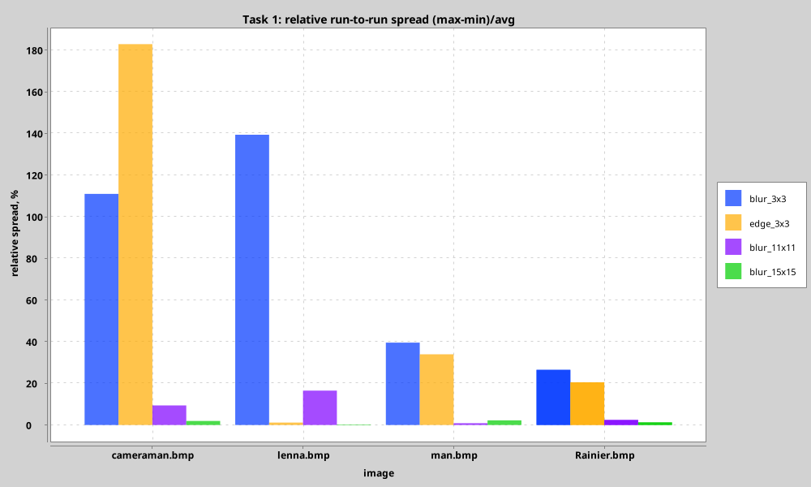
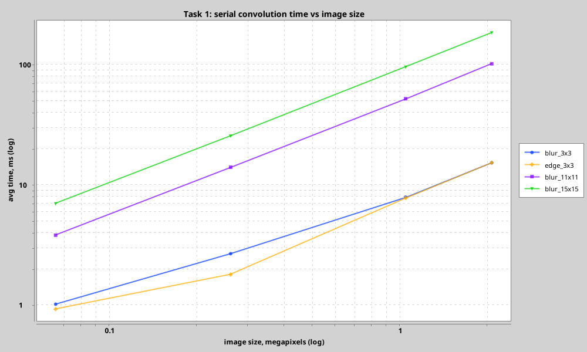
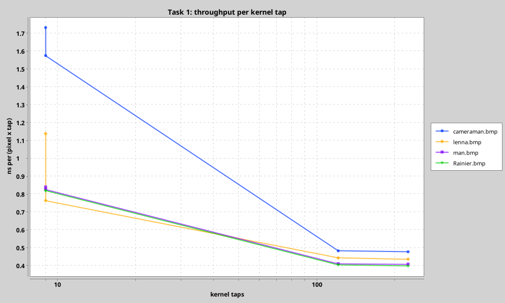

# Task 1: Serial Convolution — Performance Analysis

## Setup

- **Machine**: Intel Core Ultra 5 225H, **14 physical cores** (4P + 8E + 2LP-E, no SMT), 30 GB RAM, CachyOS
- **JVM**: Java 27 (OpenJDK), JVM target 24
- **Runs**: 1 warmup (JIT + page cache) + 5 measured runs per configuration, averaged
- **Benchmark**: `./gradlew benchmark -Ptask=serial`

## Implementation

The serial core is deliberately written for maximum single-thread throughput, so that
every later comparison (Task 2, Task 3) measures *parallelism*, not implementation waste:

1. **Kernel reflection hoisted.** A discrete convolution is a correlation with the
   180°-rotated kernel; the rotation is computed once (`flipped()`) instead of doing two
   array lookups and two index subtractions *per tap*.
2. **Wrap-around moved out of the hot loop.** Pixels whose whole kernel window fits in
   the image use a straight-line inner loop (`convolvePixelFast`: one row reference per
   kernel row, one load per tap, no modulo). Only the ≤ `2·K` border rows/columns take
   the `%`-based path. For a 1024×1024 image with a 15×15 kernel this is ~94% of pixels.
3. **Row-major tiling API.** `convolveRegion()` accepts an arbitrary `[y0,y1) × [x0,x1)`
   tile; Task 2 splits images into tiles and reuses the exact same hot loop, so parallel
   versions add only dispatch, not extra per-pixel work.

Accumulation order per pixel is identical to the naive formulation, so results are
bit-for-bit equal and the serial implementation stays a valid reference for the
parallel ones (checked in tests).

Measured single-core throughput: **~2.4 Gtap/s ≈ 4.8 GFLOPS** (blur 15×15 on man.bmp:
96.8 ms for 1.05 Mpx × 225 taps). The previous implementation of the same math — modulo
wrap-around and reflected-kernel indexing recomputed inside the inner loop — measured
363 ms for blur 11×11 on man.bmp on this machine; the optimized core does it in 52 ms
(**~7×**), so all later speedups measure parallelism, not implementation waste.

## Benchmark design — minimizing OS noise

Absolute scheduling/interrupt noise is roughly constant per run (~1–3 ms). To make it
irrelevant, each measured configuration must do enough useful work:

* **Images**: a size ladder `cameraman 256²` → `lenna 512²` → `man 1024²` →
  `Rainier 1920×1080`, up to 2 MP.
* **Kernels**: `blur 3×3`, `edge 3×3`, `blur 11×11`, `blur 15×15` (225 taps) — the heavy
  box blurs push large-image runs to 50–190 ms, where noise is ≲1%.
* **1 warmup + 5 runs** per configuration: warmup absorbs JIT tier-up and page faults;
  after that the spread is tiny (see the stability chart).
* Everything is computed in-memory from a pre-loaded `DoubleArray`; no I/O inside a
  timed region.

The spread chart shows the design working: 3×3 kernels on small images still have
tens–hundreds of percent relative spread (they are *not* used for scaling conclusions —
they only take ~1 ms of useful work), while every heavy configuration (≥ 50 ms of work)
settles at < 3% and the 1024²+15×15 / 1920×1080+15×15 cases at ~1%.

## Raw Results

Timing uses a nanosecond-resolution clock (`System.nanoTime`), so sub-millisecond
runs are not quantization artifacts.

| Image | Size | Kernel | Avg (ms) | Min (ms) | Max (ms) |
|-------|------|--------|----------|----------|----------|
| cameraman | 256×256 | blur 3×3 | 1.02 | 0.59 | 1.73 |
| cameraman | 256×256 | edge 3×3 | 0.93 | 0.56 | 2.26 |
| cameraman | 256×256 | blur 11×11 | 3.83 | 3.72 | 4.08 |
| cameraman | 256×256 | blur 15×15 | 7.04 | 6.98 | 7.12 |
| lenna | 512×512 | blur 3×3 | 2.69 | 1.83 | 5.58 |
| lenna | 512×512 | edge 3×3 | 1.80 | 1.79 | 1.81 |
| lenna | 512×512 | blur 11×11 | 14.05 | 13.55 | 15.87 |
| lenna | 512×512 | blur 15×15 | 25.74 | 25.69 | 25.76 |
| man | 1024×1024 | blur 3×3 | 7.93 | 7.25 | 10.38 |
| man | 1024×1024 | edge 3×3 | 7.80 | 7.26 | 9.91 |
| man | 1024×1024 | blur 11×11 | 52.11 | 51.88 | 52.33 |
| man | 1024×1024 | blur 15×15 | 96.33 | 95.28 | 97.44 |
| Rainier | 1920×1080 | blur 3×3 | 15.30 | 14.37 | 18.42 |
| Rainier | 1920×1080 | edge 3×3 | 15.30 | 14.48 | 17.62 |
| Rainier | 1920×1080 | blur 11×11 | 101.76 | 101.03 | 103.51 |
| Rainier | 1920×1080 | blur 15×15 | 185.96 | 184.25 | 186.56 |

Full data: [`docs/benchmark_task1.csv`](../docs/benchmark_task1.csv)
(charts are regenerated from this table by the benchmark itself into `docs/charts/`).

## Analysis

### Scaling with image size

Straight lines on log-log axes: time grows linearly with pixel count for every kernel
(e.g. man → Rainier ≈ 2× pixels → 1.9× time on all kernels). Confirms O(W·H·Kw·Kh).

### Scaling with kernel size & constant throughput

Time per (pixel × tap) is ~0.4–1.1 ns and drops for larger kernels: one tap costs the
same everywhere, only the small-kernel cases pay the fixed per-pixel loop overhead.
This is the evidence that the hot loop is running at constant hardware throughput
(~2.4 Gtap/s single-core), i.e. measurements above are throughput, not noise.

### Wrap-around vs zero-padding

Wrap-around (cyclic) boundary was chosen because:

1. Mathematically correct for filter composition tests (shift-left ∘ shift-right = identity)
2. No border artifacts from zero-padding
3. Consistent behavior regardless of kernel size

Downside: introduces a discontinuity at image edges for natural images (visible with large kernels).

### Baseline for Task 2

The serial implementation serves as the **reference** for all parallel strategies:
any parallel result must match it bit-for-bit (tested). Its ~2.4 Gtap/s per core sets the
expected ceiling for Task 2 on the 14-core Ultra 5 225H; the Task 2 benchmark therefore
sweeps the number of OS threads the convolution may use (1…14) instead of the coroutine
count, and measures how close chunked parallelism gets to `threads × serial`.
