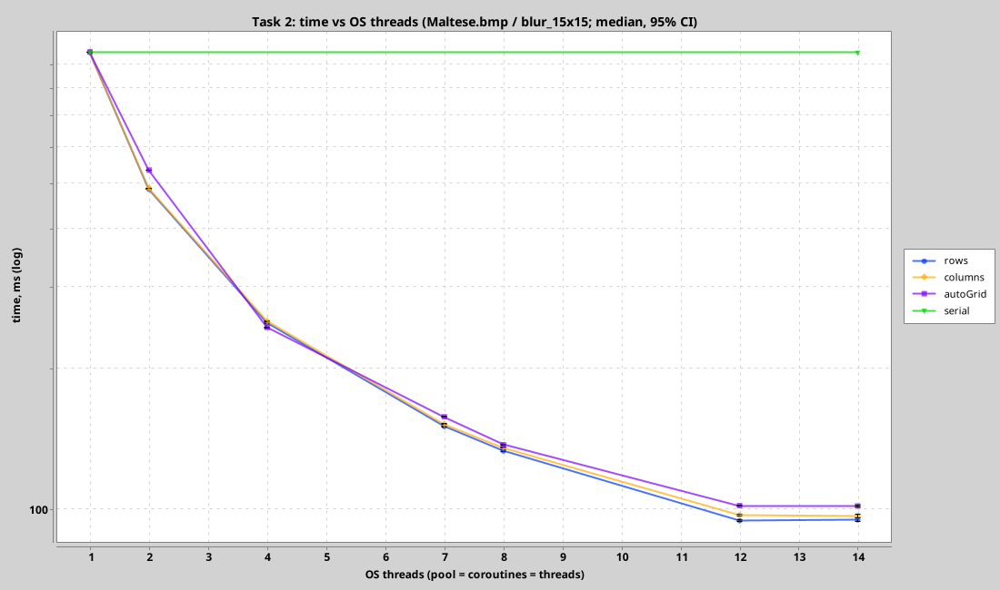
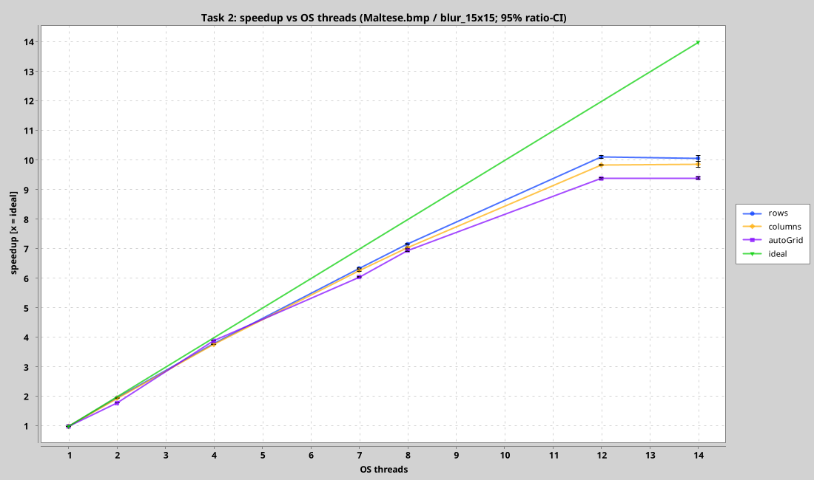
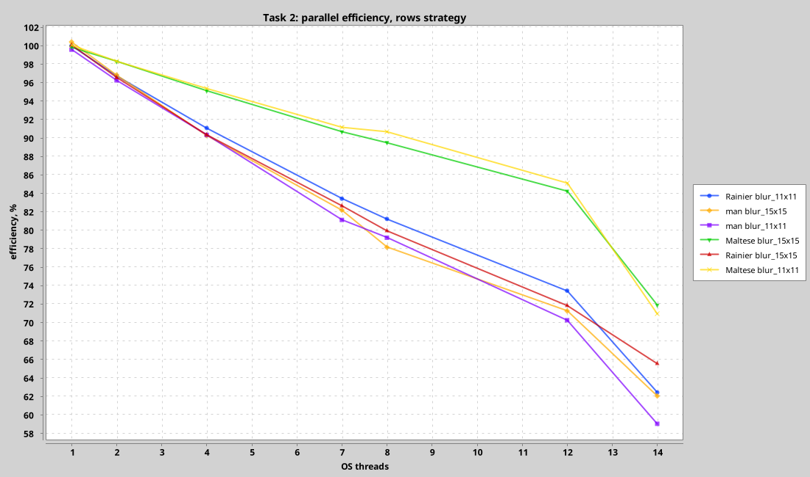
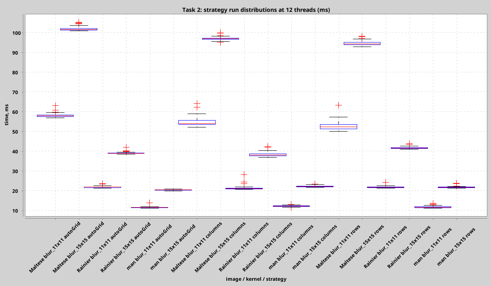
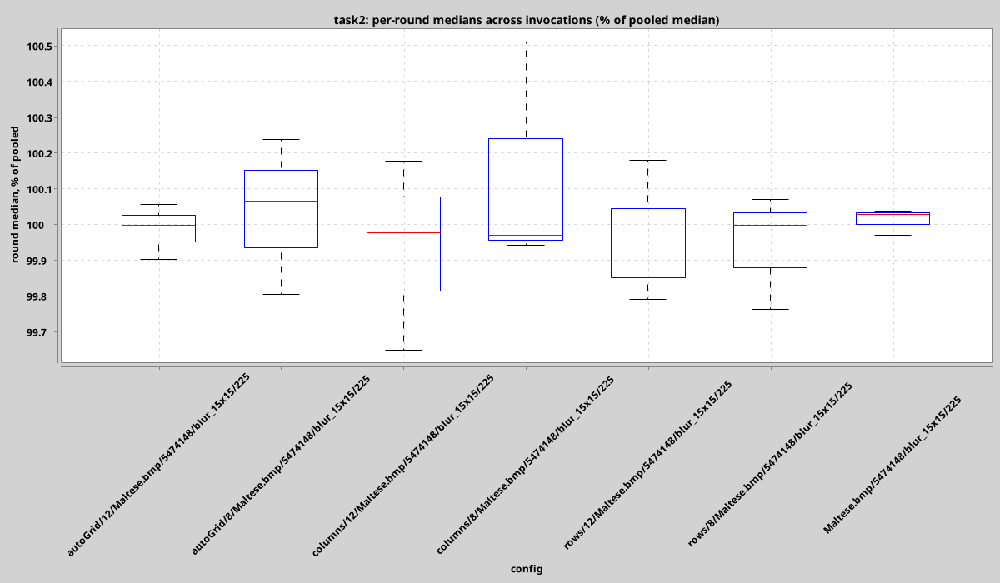

# Задача 2: параллельная свёртка — масштабирование по числу ОС-потоков

## Условия и протокол

- **Машина**: Intel Core Ultra 5 225H (4P + 8E + 2LP-E, без SMT), CachyOS;
  JDK 27, Kotlin 2.4.21, корутины 1.11.0.
- **Замер** (`sudo -E ./bench-all.sh`): 3 независимых запуска процесса
  бенчмарка; в каждом — 1 разогрев + 9 чередующихся итераций на конфигурацию
  → **27 сырых замеров в наносекундах** на конфигурацию. Агрегаты: медиана,
  квартили, bootstrap 95% CI (`./gradlew charts`).
- **Управление средой**: эксперимент на ядрах **0–11** (4P+8E); LP-ядра 12–13 —
  housekeeping с всеми прерываниями; **все ядра заперты на 2.5 ГГц**,
  governor=performance. JVM видит 12 доступных процессоров: это и есть
  «число доступных ОС-потоков», от которого строится кривая.
- **Свип потоков**: {1, 2, 4, 7, 8, 12, 14} — 12 = все доступные ядра,
  14 = контроль оверсубскрипции (точка 28 протоколом отфильтрована как
  > 2×12).
- **Данные**: сырые замеры — [`docs/benchmark_task2.csv`](../docs/benchmark_task2.csv),
  агрегаты — `docs/benchmark_stats_task2.csv`, воспроизводимость —
  `docs/benchmark_repeatability_task2.csv`.

## Модель параллельной реализации

Экспериментальная ось — **только число ОС-потоков** и **форма нарезки**
(требование задачи 2.1); число корутин нигде не является свободным параметром:

1. Каждая стратегия запускает ровно `threads` корутин на фиксированном пуле из
   `threads` ОС-потоков (`newFixedThreadPoolContext(threads)`).
2. Изображение нарезается на ~4 тайла на воркера (полосы строк / полосы
   столбцов / прямоугольная сетка) и раздаётся через один атомарный курсор —
   никаких объектов планирования на тайл, и быстрые ядра автоматически
   забирают больше тайлов.
3. Каждый тайл считается тем же самым горячим циклом `convolveRegion` из
   задачи 1 → результаты побитово совпадают с последовательным эталоном
   (тестируется для всех чисел потоков 1…21).
4. Стратегия «корутина на пиксель» (п. 2.1.1) сохранена в коде и тестах как
   учебный предел, но из бенчмарка исключена: она измеряет оверхед создания
   корутин, а не скорость.

## Скорость и ускорение

### Maltese.bmp 2238×2446, blur 15×15 (1.23 млрд тапов; serial = 955.5 ± 0.9 мс)

| threads | rows, мс | columns, мс | autoGrid, мс | ускорение rows / cols / grid |
|--------:|---------:|------------:|-------------:|:----------------------------|
| 1  | 956.6 ±0.9 | 958.1 ±0.5 | 957.6 ±0.7 | 1.00 / 1.00 / 1.00 |
| 2  | 486.0 ±0.4 | 488.6 ±0.5 | 534.4 ±0.3 | 1.97 / 1.96 / **1.79** |
| 4  | 251.1 ±0.4 | 253.5 ±0.5 | 245.5 ±0.6 | 3.81 / 3.77 / 3.89 |
| 7  | 150.5 ±0.2 | 152.4 ±0.4 | 157.9 ±0.5 | 6.35 / 6.27 / 6.05 |
| 8  | 133.4 ±0.5 | 135.7 ±0.6 | 137.5 ±0.4 | 7.16 / 7.04 / 6.95 |
| 12 | **94.5 ±0.5** | 97.1 ±0.3 | 101.8 ±0.3 | **10.11** / 9.84 / 9.39 |
| 14 | 94.9 ±0.9 | 96.8 ±0.9 | 101.6 ±0.3 | 10.07 / 9.87 / 9.40 |

### Rainier.bmp 1920×1080, blur 15×15 (serial = 360.1 ± 0.7 мс)

| threads | rows | columns | autoGrid | ускорение rows / cols / grid |
|--------:|-----:|--------:|---------:|:----------------------------|
| 2  | 186.5 | 184.4 | 201.1 | 1.93 / 1.95 / 1.79 |
| 4  | 99.6  | 96.5  | 92.9  | 3.61 / 3.73 / 3.88 |
| 8  | 56.3  | 52.6  | 52.9  | 6.40 / 6.85 / 6.81 |
| 12 | 41.8  | **38.2** | 39.1 | 8.63 / **9.43** / 9.20 |
| 14 | 39.2  | 38.4  | 39.2  | 9.18 / 9.37 / 9.20 |

Лучший результат на 12 доступных ядрах: **10.2×** (rows, Maltese 11×11 —
52.6 ± 0.6 мс) — 85% от линейного идеала; полная матрица конфигураций — в CSV.

## Воспроизводимость

Отклонение медиан трёх независимых запусков от пула (пер-конфигурационно):
**медиана 0.26%, p90 1.25%, худший случай 1.98%**
([`docs/charts/task2_repeatability.png`](../docs/charts/task2_repeatability.png)).
Значит: различия ≥ 2× достоверны; различия 1–8% между стратегиями ниже
разрешающей способности по отдельности, но согласованы по всем конфигурам
(см. ниже — они и там невелики).

## Анализ

### Форма кривой: 4 ядра почти идеально, дальше — регрессия E-ядер

- **t ≤ 4**: 3.77–3.89× — все потоки на P-ядрах, эффективность 94–97%;
  оверхед пула невидим (rows@t1 = serial@t1 с точностью 0.1%).
- **t = 8**: ≈ 7.0–7.2× — OS добавляет 4 E-ядра. Если принять E ≈ 0.75 P при
  равных частотах, модель даёт 4 + 4·0.75 = **7.0** — измерено 6.95–7.16.
- **t = 12**: 9.39–10.22× — модель 4 + 8·0.75 = **10** — снова совпадает.
  Обратная оценка по данным: E-ядро на этой работе даёт **0.68–0.78 P-ядра**
  при равном такте.
- **t = 14**: статистически то же, что t = 12 (Δ ≤ 1.5% при CI ~1%) —
  14 корутин на 12 ядрах не портят makespan: динамическая раздача тайлов
  делает оверсубскрипцию безвредной (прерванный тайл просто добирается позже).

Итог по протоколу с равными частотами: плато на **~85% линейного** — это
архитектурная правда про E-ядра, а не лотерея буста и не потери реализации
(совокупная производительность rows@12: 12.9 Gtap/s, 1.07 Gtap/s/ядро-эквивалент).

### Форма нарезки (п. 2.1) важнее на мезоне, чем на плато

- Полосы строк vs полосы столбцов расходятся **не более чем на ±8%** и направление
  зависит от ориентации кадра: на вертикальной Maltese выигрывают строки
  (94.5 vs 97.1 мс), на горизонтальной Rainier — столбцы (38.2 vs 41.8).
  Классическая «катастрофа колоночного доступа» не воспроизводится: даже узкая
  полоса столбцов читает память последовательными окнами строк, а входной
  кадр на 2 МП почти целиком живёт в общем L3.
- **autoGrid платит за квантование**: при t=2 сетка даёт 9 блоков (3×3), два
  воркера делят их как 5+4 → предсказанный потолок 2/(5/9) = **1.80** —
  измерено 1.78–1.79 точно по модели. При t=12: 49 блоков на 12 воркеров
  (4·12=48 ≤ 49 ≤ 5·12) → потери тех же 8%. При t=4 (16 блоков) сетка,
  наоборот, чуть впереди всех.
- Вывод: форма тайла — параметр на уровне единиц процентов; главный фактор —
  число ОС-потоков и их качество (P/E).

### Динамическая раздача против статической

Статическая нарезка «по полосе на поток» на гетерогенной машине отдёт
makespan во власть самого медленного тайла (полоса на E-ядре длится в ~1.3–1.5×
дольше), а при неудачном размещении разброс прогонов взрывается. Атомарный
курсор с ~4 тайлами на воркера убирает обе проблемы: быстрые ядра берут
больше полос, makespan сходится к «работа / суммарная пропускная
способность», и кривая становится гладкой и воспроизводимой в пределах 2%
(см. repeatability выше).

### Проверка cost-модели

serial-замеры задачи 2 совпадают с задачей 1 в пределах 0.7% (955.5 vs 958.1
мс для Maltese 15×15 — разные прогоны), rows@t1 — в пределах 0.2% ⇒ диспетчеризация
пула и атомарный курсор не стоят измеримого времени; вся кривая — это железо.

## Рекомендации

1. Рабочая точка на этой машине в рамках протокола: **12 потоков, rows или
   columns** (выбор по ориентации кадра), autoGrid — если нужна «универсальная»
   форма с потерей ≤8%.
2. Больше потоков, чем физических ядер в cpuset, добавлять бессмысленно
   (t=14 ≈ t=12), но и безопасно.
3. Единственный способ догнать «12×» — гетерогенный планировщик, знающий,
   что E-ядро ≈ 0.75 P (задача 4+, здесь не реализуется).

## Мостик к задаче 3

Свёртка 2 МП-кадра 15×15 стоит ~39 мс на 12 потоках (~19 мс/МП), I/O того же
кадра — десятки миллисекунд: стадии нужно перекрывать, а не последовать.
Открытый вопрос для замера в задаче 3: параллелить **между** картинками
(W serial-воркеров) или **внутри** каждой (tile-параллельная свёртка на общем
пуле)? Межкадровый вариант проще, но его makespan упирается в самую большую
картинку датасета; внутрикадровый даёт ту же глобальную очередь тайлов, что
объяснила задача 2. Замеряем оба.
