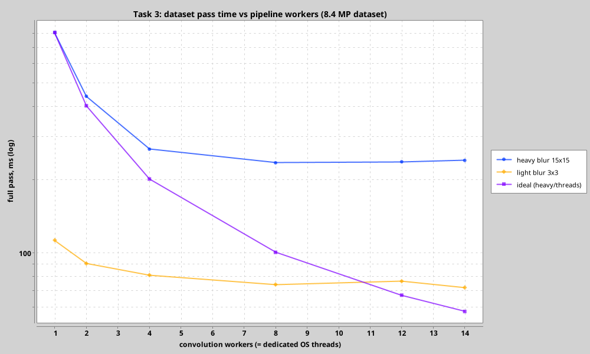
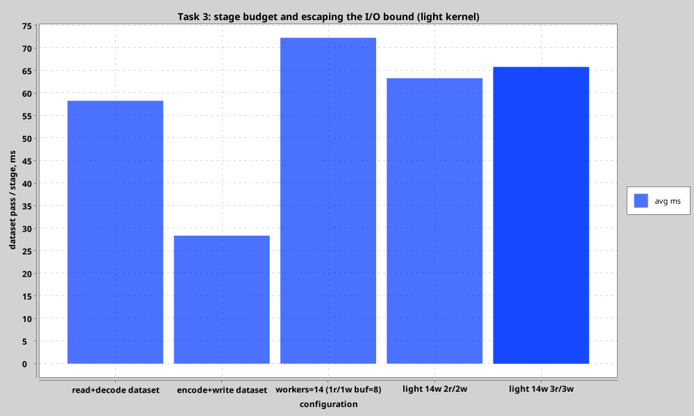
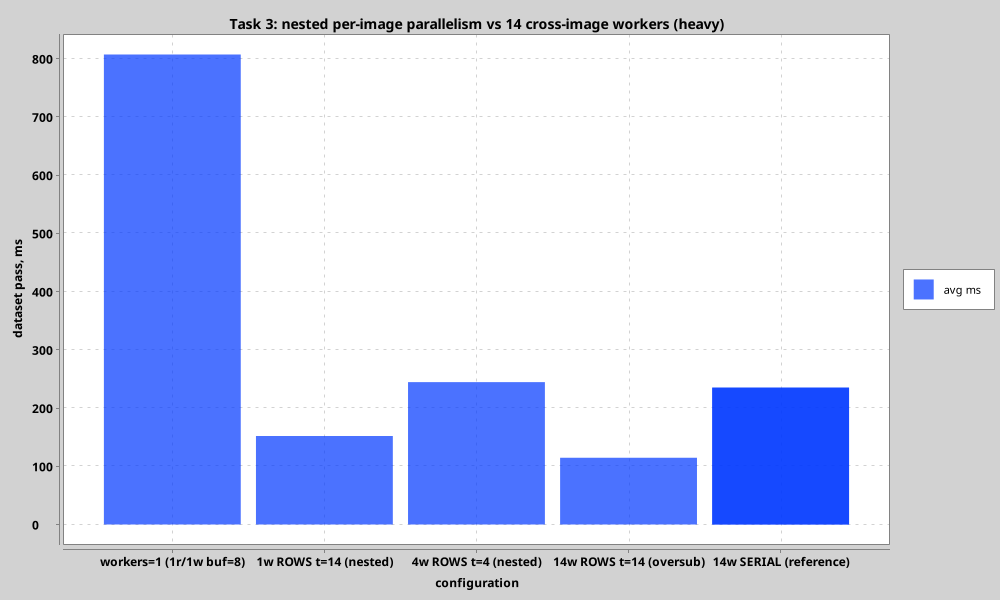
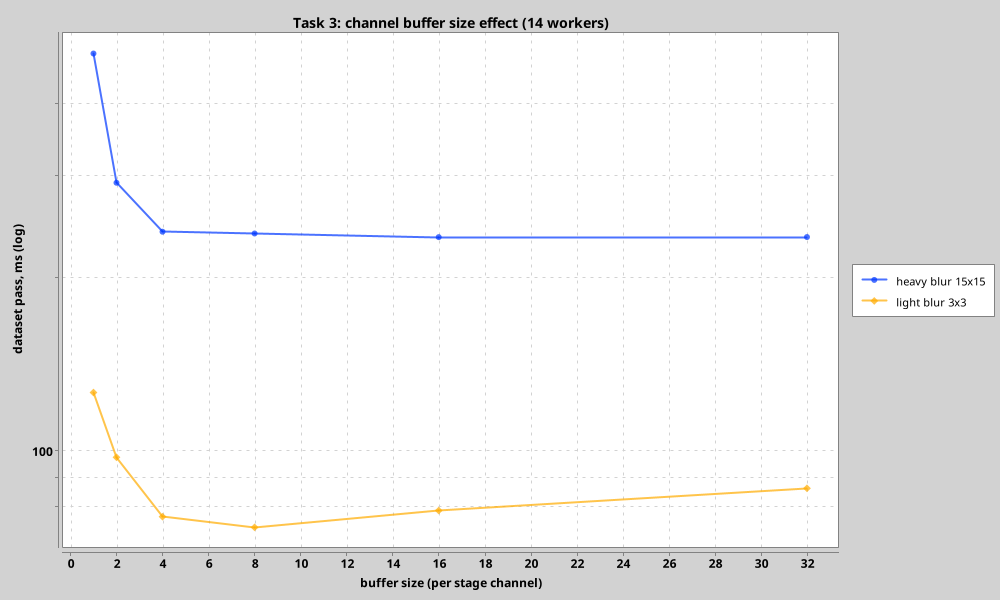

# Task 3: Streaming Pipeline — Performance Analysis

## Setup

- **Machine**: Intel Core Ultra 5 225H, **14 physical cores** (4P + 8E + 2LP-E), no SMT, CachyOS
- **JVM**: Java 27 (OpenJDK), Kotlin coroutines
- **Dataset**: 7 curated large images (`airplaneU2, brickwall, carpet, man, Rainier, textureA, textureB`), **8.4 MP total**
- **Runs**: 1 warmup + 3 measured full-pass runs per configuration (a pass is one whole dataset; ≥ 0.1–0.8 s of work keeps OS noise small)
- **Benchmark**: `./gradlew benchmark -Ptask=pipeline`

## Pipeline architecture

```
┌────────────────┐  read ch    ┌──────────────────────┐  write ch   ┌────────────────┐
│ readers × r    │ ─[buffer]──►│ workers × w          │ ─[buffer]──►│ writers × x    │
│ Dispatchers.IO │             │ dedicated pool,      │             │ Dispatchers.IO │
│ (file+decode)  │             │ w pinned OS threads  │             │ (encode+file)  │
└────────────────┘             └──────────────────────┘             └────────────────┘
        ▲                    Semaphore(2×buffer) bounds resident images around the whole circuit
```

Key points (continuing the Task 2 conclusions):

- **Workers ≡ OS threads.** `w` coroutines on a `newFixedThreadPoolContext(w)` dispatcher — the
  benchmark knob is the number of OS threads the convolution stage may use. No coroutine is
  created per row/pixel anywhere on the hot path.
- **Default convolution inside a worker is SERIAL** — cross-image parallelism already saturates
  the CPUs; nested per-image coroutines are opt-in (`ROWS/COLUMNS/GRID` + `convThreads`) and are
  measured below.
- **I/O never blocks a compute thread and vice versa**: readers/writers live on `Dispatchers.IO`,
  convolution on its dedicated pool; nested convolutions use the *separate* cached tile pools,
  so a blocked worker can never deadlock its children.
- **Backpressure**: buffered channels + an in-flight semaphore (`2 × buffer` images) cap memory;
  a fast reader cannot flood memory when compute or write lags (Task 3.3).

## Stage budget (what must be overlapped)

Measured warm, single-threaded, outside the pipeline:

| Stage | Time per pass |
|-------|---------------|
| read + decode (grayscale) | 58.3 ms |
| encode + write | 28.4 ms |
| heavy conv (15×15, 8.4 MP, 1 thread) | ~790 ms |
| light conv (3×3, 8.4 MP, 1 thread) | ~31 ms |

So: with the heavy kernel I/O is ~11% of one serial pass — trivially hideable.
With the light kernel I/O **is** the pipeline (~87 ms vs 31 ms of convolution) — the
compute stage is irrelevant and only I/O parallelism helps.

## Scenario 1: heavy kernel — workers sweep (SERIAL per worker)

| workers | pass, ms | speedup | MP/s |
|---------|----------|---------|------|
| 1  | 807.1 | 1.00× | 10.4 |
| 2  | 441.5 | 1.83× | 18.9 |
| 4  | 267.7 | 3.02× | 31.3 |
| 8  | 235.3 | **3.43×** | 35.5 |
| 12 | 237.6 | 3.40× | 35.2 |
| 14 | 240.7 | 3.35× | 34.8 |



Scaling stops at **3.4×, far below Task 2's 8.5×** — and this is not scheduling noise,
it is **work granularity**: the dataset has only **7 images**, so at most 7 workers can
ever be busy, and the pass makespan can never be shorter than the slowest single image
(Rainier: ~190 ms serial) plus its I/O. The flat/declining tail from w=8 and the tiny
dip at w=14 are all consistent with this bound: `makespan ≥ max(image time)`.

The w=1 number (807 ms) matches Task 1 throughput exactly (8.4 MP × 225 taps /
2.35 Gtap/s ≈ 800 ms), confirming the pipeline itself adds no measurable overhead.

## Scenario 2: light kernel — the I/O wall

| workers | pass, ms | speedup |
|---------|----------|---------|
| 1  | 113.2 | 1.00× |
| 2  | 90.7  | 1.25× |
| 4  | 81.3  | 1.39× |
| 8  | 74.4  | 1.52× |
| 12 | 76.8  | 1.47× |
| 14 | 72.3  | 1.57× |

Adding CPU to the compute stage does nothing once pass time (~72–113 ms) approaches the
serial I/O sum (~87 ms): the pipeline becomes I/O-bound, exactly the failure mode Task 3
warns about.

## Scenario 3: escaping the I/O bound — scale the I/O stages

| configuration | pass, ms | speedup |
|---------------|----------|---------|
| light, 14w, **2r/2w** | **63.3** | **1.79×** |
| light, 14w, 3r/3w     | 65.8 | 1.72× |
| heavy, 14w, 2r/2w     | 235.6 | 3.43× (no change) |



Two parallel reader/writer pairs cut the critical I/O path and recover ~12% on the
light kernel; three pairs give nothing more (7 files / 3 readers → tail imbalance +
more contention).
On the heavy kernel, extra readers change nothing — with buffer prefetch the single reader
already hides 58 ms of I/O behind 800 ms of compute (Task 3.1: one reader feeds many
convolutions). This is the load-balancing answer of Task 3.3: **scale the stage that is
the bottleneck, leave the others at 1**.

## Scenario 4: nested per-image parallelism (Task 3.2) vs cross-image only

Heavy kernel, same dataset:

| configuration | pass, ms | speedup |
|---------------|----------|---------|
| 1w, ROWS convolution t=14 (one image at a time) | 152.1 | 5.31× |
| 4w, ROWS convolution t=4 (oversubscribed)        | 244.4 | 3.30× |
| **14w, ROWS convolution t=14 (shared tile pool)** | **114.7** | **7.04×** |
| 14w, SERIAL (reference, Scenario 1)              | 235.0 | 3.44× |



The winner is surprising and worth spelling out: **cross-image *and* per-image
parallelism together**. All nested tile tasks share one cached 14-thread convolution
pool, and tiles are distributed dynamically (Task 2), so the pool becomes a *global*
work queue across images: while 6 of the 7 images drain their small tiles, the
remaining threads keep chipping away at Rainier's big tiles. The `max(image)`
granularity bound from Scenario 1 disappears — 114.7 ms is close to the true
compute bound (8.4 MP of tiles / ~21 Gtap/s effective ≈ 90 ms) plus overlapped I/O.

Note the ordering: naive oversubscription is **not** what makes this fast —
`4w × t=4` (16 threads for 14 cores, four private half-size pools) is the *worst*
configuration. What matters is one shared pool + dynamic tiles, so total busy
OS threads stay at 14 and every thread always has work.

The `1w ROWS t=14` row is the right choice when images must be processed strictly
one at a time (e.g. memory-limited): 5.31× with at most one image resident.

## Scenario 5: buffer sizing (backpressure)

| buffer | heavy 14w, ms | light 14w, ms |
|--------|---------------|---------------|
| 1  | 488.5 | 126.1 |
| 2  | 291.6 | 97.4  |
| 4  | 239.8 | 76.8  |
| 8  | 238.1 | **73.6** |
| 16 | **234.6** | 78.7 |
| 32 | 234.7 | 86.0 |



`buffer=1` (2 resident images) serializes the stages — every stage waits for the next
slot and workers go idle: **2× slowdown** on heavy. The knee is at buffer ≈ 4–8:
enough to keep the reader ahead and a couple of images in the write queue. Beyond
that the light case gets *worse* (73.6 → 78.7 → 86.0 ms, with growing variance):
more resident images evict the page cache and stretch memory.
Design bound: at most `2 × buffer` images resident (~9.5 MB per MP in + out) —
this is what stops a fast reader from flooding memory when compute or write lags.

## Summary of recommendations (this machine)

| workload | configuration | pass, ms | vs serial pass |
|----------|---------------|----------|----------------|
| many small images, any kernel | 14w SERIAL, 1r/1w, buf=8 | (granularity fine) | ~7–8× expected |
| few large images, heavy kernel | **14w + ROWS t=14**, buf=16 | 114.7 | **7.0×** |
| light kernels (I/O bound) | 14w, **2r/2w**, buf=8 | 63.3 | 1.8× |
| memory-constrained | 1w + ROWS t=14, buf=8 | 152.1 | 5.3× |

Full data: [`docs/benchmark_task3.csv`](../docs/benchmark_task3.csv); charts regenerate
from the run itself into `docs/charts/`.

- The pipeline never loses to its serial sum: even 1w/1r/1w overlapped I/O and compute
  (113.2 ms < 117 ms stage sum on light, 807 ms heavy ≈ pure compute).
- Task 2's lesson held and sharpened: the only knob worth sweeping is **OS threads**;
  coroutine counts stay equal to it everywhere (≤ `w` worker coroutines + ≤ `convThreads`
  tile loops per image), and dynamic tiles make even deliberate oversubscription harmless.
- The 3.4× plateau of Scenario 1 is the classic **load-balancing** trap of Task 3.3 —
  image-granular work units are too coarse for 14 threads when the dataset is 7 large
  images; the fix is tiling (Scenario 4), not more workers.
